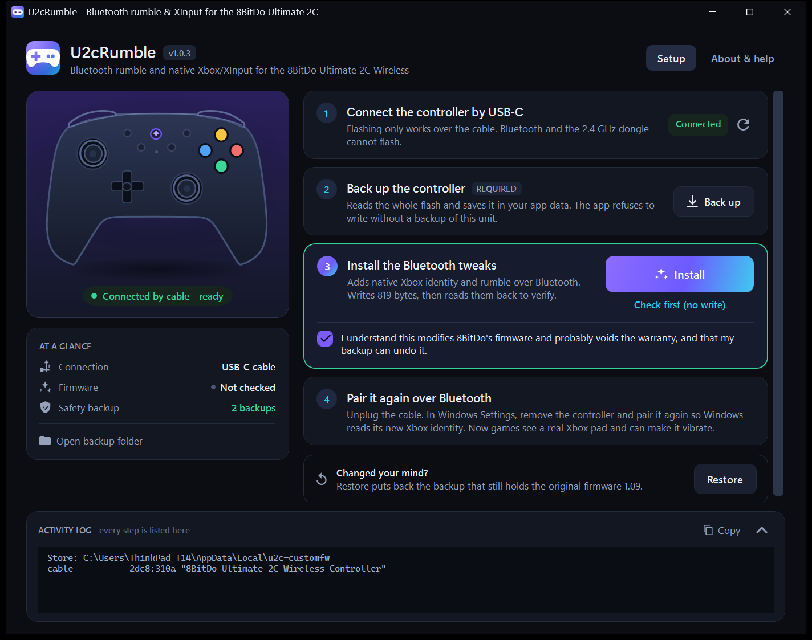
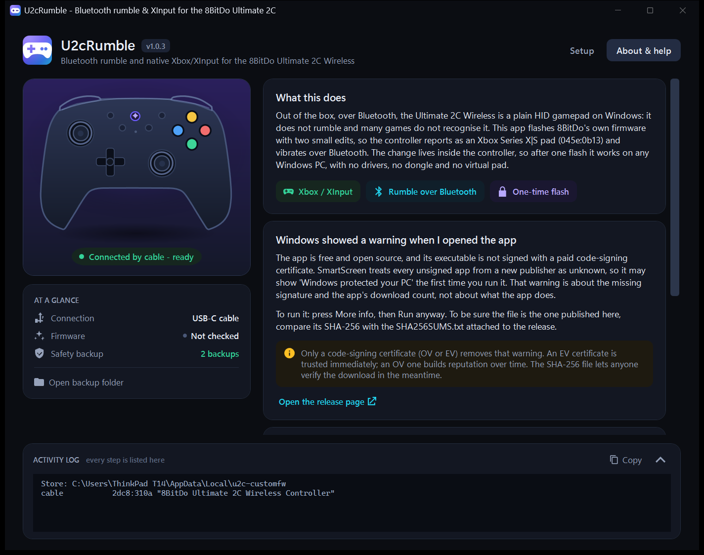

# 8BitDo Ultimate 2C Wireless — Bluetooth Rumble & XInput for Windows

**Convert your 8BitDo Ultimate 2C Wireless to XInput over Bluetooth on Windows 11**: real **rumble over Bluetooth** and a **native Xbox controller** identity, with no drivers, no dongle and no virtual pad.

Out of the box, over Bluetooth, the Ultimate 2C Wireless is a plain HID gamepad on Windows: it does not rumble, and many games do not recognise it. This app flashes 8BitDo's **own** firmware with two small tweaks, so the controller presents itself as an **Xbox Series X|S** pad and **vibrates over Bluetooth**. The change lives inside the controller, so after one flash it works on any Windows PC.

> **Use at your own risk.** Flashing modified firmware probably voids the controller's warranty. It is reversible (your backup restores the original firmware), but it is not risk-free. Read the [disclaimer](#safety-and-disclaimer) before you start. This project is **not affiliated with or endorsed by 8BitDo**.

**[Download the latest release](https://github.com/JehuAlv/8bitdo-ultimate-2c-wireless-rumble/releases/latest)** — a self-contained Windows x64 `.exe`, no .NET runtime or Python needed.

## Screenshots





## What it does

| Feature | What it changes |
| --- | --- |
| **Native Xbox over Bluetooth** | The controller reports as an **Xbox Series X\|S** pad (`045e:0b13`), so Windows and games see it as a real Xbox controller through **XInput**. |
| **Rumble over Bluetooth** | Games can make it vibrate over Bluetooth, which the stock firmware does not allow. Both motors work. |
| **Fewer Bluetooth interruptions** | The Bluetooth connection interval is tuned so the pad stays responsive. |

Everything else stays as it was. The tweaks only touch the firmware's application area; the bootloader, the calibration and the Bluetooth pairings are never modified.

### Why the flashing is needed

The tweaks are small edits to the firmware that runs **inside the controller**. That is why, once flashed, the controller works on **any** Windows PC — you only need this tool once. The stock firmware simply has no code path that accepts rumble commands over Bluetooth.

## Requirements

- **8BitDo Ultimate 2C Wireless** controller (the PC SKU with the 2.4 GHz dongle) on **firmware 1.09**.
- **Windows 11** (x64).
- A **USB-C data cable** for the one-time flash. Bluetooth cannot flash the controller.
- To run the released app, nothing else: it is a single self-contained `.exe`.
- To build it, the **.NET 10 SDK**. There is **no Python** in this project.

## How to use

1. **Back up.** Connect the controller **by cable** and press *Back up controller*. The backup is the safety net: it contains your unit's bootloader check, calibration and Bluetooth keys, and the app refuses to write anything without one.
2. **Check.** Press *Check (no write)* to see what would change.
3. **Install the tweaks.** Tick the disclaimer box and press *Install Bluetooth rumble*. The app puts the controller into update mode, writes the changes, verifies them and restarts it.
4. **Pair again.** Remove the controller in **Settings → Bluetooth & devices** and pair it again, so Windows re-reads the new description.
5. **Play.** Turn the controller on over Bluetooth. Windows shows it as an Xbox controller and games can make it vibrate.

To go back, **restore your backup** the same way. The app puts back the newest backup that still holds the original firmware, so restoring also undoes the tweaks.

### Recovery

The bootloader is never written, so a failed or interrupted write is always recoverable:

> Turn the controller fully off, hold **L1 + R1**, and plug in the USB cable. It starts in update mode (the LED blinks white). From there you can restore your backup. This works **only over USB**.

### Windows says "Windows protected your PC"

The app is free and open source, and the `.exe` is not signed with a paid code-signing certificate. SmartScreen treats every unsigned app from a new publisher as unknown, so the first time you run it Windows may show **Windows protected your PC** with an *Unknown publisher* note. That warning is about the missing signature and the download count, not about what the app does.

To run it, press **More info**, then **Run anyway**.

To check that the file is the one published here, compare its SHA-256 with the value in `SHA256SUMS.txt` from the same release:

```powershell
Get-FileHash .\U2cRumble-1.0.3-win-x64.exe -Algorithm SHA256
```

Only a code-signing certificate (OV or EV) removes that warning for everyone; a self-signed certificate does not help. The app is open source, so the code that runs is the code in this repository.

### Making the warning go away

**For your own copy:** remove the internet tag that Windows puts on downloaded files. Right-click the `.exe`, open **Properties**, tick **Unblock**, then **OK**. In PowerShell the same thing is:

```powershell
Unblock-File .\U2cRumble-1.0.3-win-x64.exe
```

SmartScreen only checks files that carry that tag, so this copy opens without the prompt. It does not change the file's contents and it does not help anyone else.

**For everyone who downloads it:** sign the executable. Only a certificate from a certificate authority removes the prompt at the source:

- **EV certificate**: trusted from the first download.
- **OV certificate**: the prompt fades as the file builds reputation.
- **Azure Trusted Signing**: Microsoft's subscription signing service.

All of them verify your identity, so none is free. A self-signed or test certificate keeps the publisher unknown.

When you have a certificate, `scripts/sign.ps1` signs the single-file build with SHA-256 and an RFC 3161 timestamp, then verifies the result:

```powershell
# with a .pfx file
.\scripts\sign.ps1 -Pfx .\cert.pfx -Password "the password"

# or with a certificate already in the Windows certificate store
.\scripts\sign.ps1 -Thumbprint 0123456789ABCDEF0123456789ABCDEF01234567
```

It needs `signtool.exe` from the Windows SDK (the *Signing Tools* component). Signing changes the file, so recalculate the SHA-256 and upload the signed executable again when you publish.

## Project layout

```
app/U2cRumble.Core/   the flashing core, 100% C# (HID, protocols, tweaks, backup, patch, restore)
app/U2cRumble/        the WPF desktop app (Setup and About tabs)
tests/ParityCheck/    proves the C# builder matches the validated reference image
tests/HardwareCheck/  runs devices, backup and check from the console
```

`U2cRumble.Core` uses Win32 HID calls directly, with no external packages.

## Build and run

```sh
git clone https://github.com/JehuAlv/8bitdo-ultimate-2c-wireless-rumble
cd 8bitdo-ultimate-2c-wireless-rumble

dotnet build app/U2cRumble/U2cRumble.csproj -c Release
dotnet run --project app/U2cRumble/U2cRumble.csproj
```

### Run it headless

The same core is available from the command line, which is handy for checking a controller without the window:

```sh
dotnet run --project tests/HardwareCheck/HardwareCheck.csproj -- devices
dotnet run --project tests/HardwareCheck/HardwareCheck.csproj -- backup
dotnet run --project tests/HardwareCheck/HardwareCheck.csproj -- check
dotnet run --project tests/HardwareCheck/HardwareCheck.csproj -- restore-check
```

`devices`, `check` and `restore-check` never write; `backup` only reads the controller and saves the file.

### Verify the port

The tweaks were ported from the original Python toolkit and validated **byte for byte** before release. Point the parity test at a full backup of a stock 1.09 controller:

```sh
dotnet run --project tests/ParityCheck/ParityCheck.csproj -c Release -- controller-*.bin
```

It rebuilds the firmware from the backup and checks the size, the SHA-256, the recognised tweaks and the stock hash. If you also pass an image produced by the original core, it compares every byte.

## Safety and disclaimer

- **Warranty:** installing modified firmware probably voids the controller's warranty.
- **Reversible:** the bootloader is never touched, so recovery is always possible over USB.
- **Tested on one unit:** the tweaks were validated on one Ultimate 2C Wireless. Edge cases may exist.
- **Reported risk:** making the motors run during an active Bluetooth link has been reported to hang the controller in one instance; the toolkit author ran both motors at full strength for 30 seconds without reproducing it. This is a behaviour risk, not a brick risk.
- See [DISCLAIMER.md](DISCLAIMER.md) for the full text and [SAFEGUARDS.md](SAFEGUARDS.md) for every check the app makes before writing.

## Credits

This project stands on other people's work. See [CREDITS.md](CREDITS.md) for the full list.

- **Carlos Browne F.** — [carlosbrownef-source/8bitdo-ultimate-2c-toolkit](https://github.com/carlosbrownef-source/8bitdo-ultimate-2c-toolkit) (GPL-3.0-or-later): the U2C Firmware Toolkit, its flashing core, the `bt_xbox` and `bt_rumble` tweaks and all the reverse engineering behind them. The C# core in this repository is a port of that work.
- **jgus-org/8bitdo-2c-re-flake** (MIT): reverse engineering of the update and bootloader protocols and the flash layout.
- **xpadneo**, **supercypok/ultimate2c-ring**, **Crazyawk/8bitdo-ultimate2c-macos-rumble**, **vomba/8bitdo-ultimate-2c-apple**, **MoridaDE/8bitdo-2c-battery-tray**: descriptor and technique references.

## License

**GPL-3.0-or-later**. See [LICENSE](LICENSE).

Not affiliated with or endorsed by 8BitDo.

---

**Keywords:** 8BitDo Ultimate 2C Wireless, Bluetooth rumble, convert to XInput, Xbox controller on Windows 11, native XInput, gamepad rumble fix, HID, firmware tweak.
